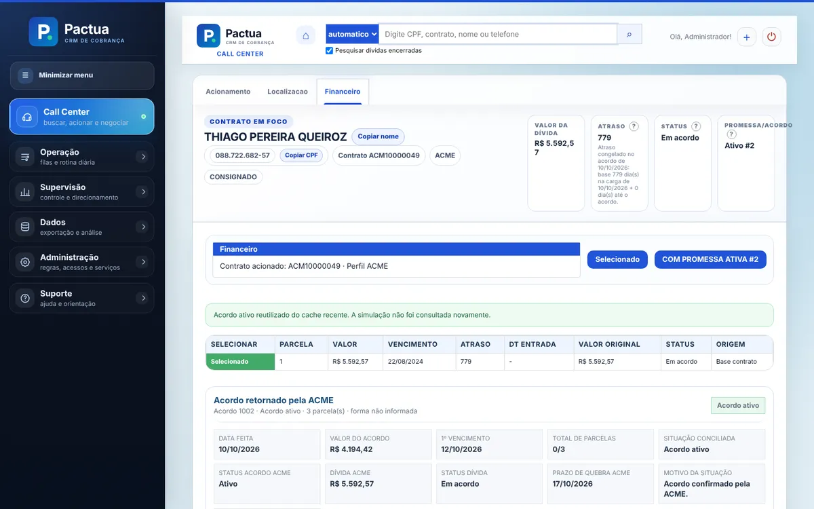
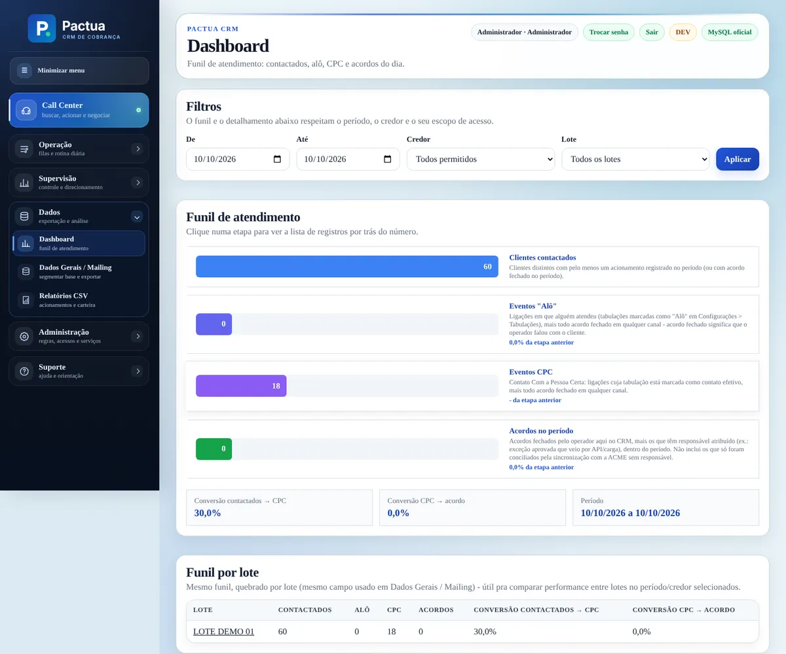
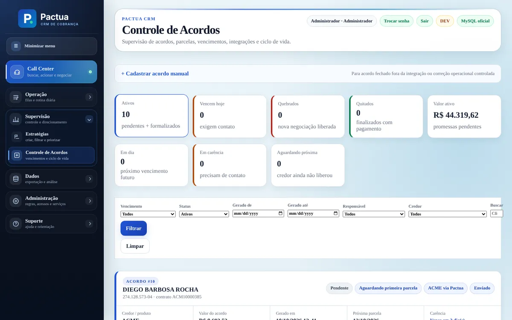
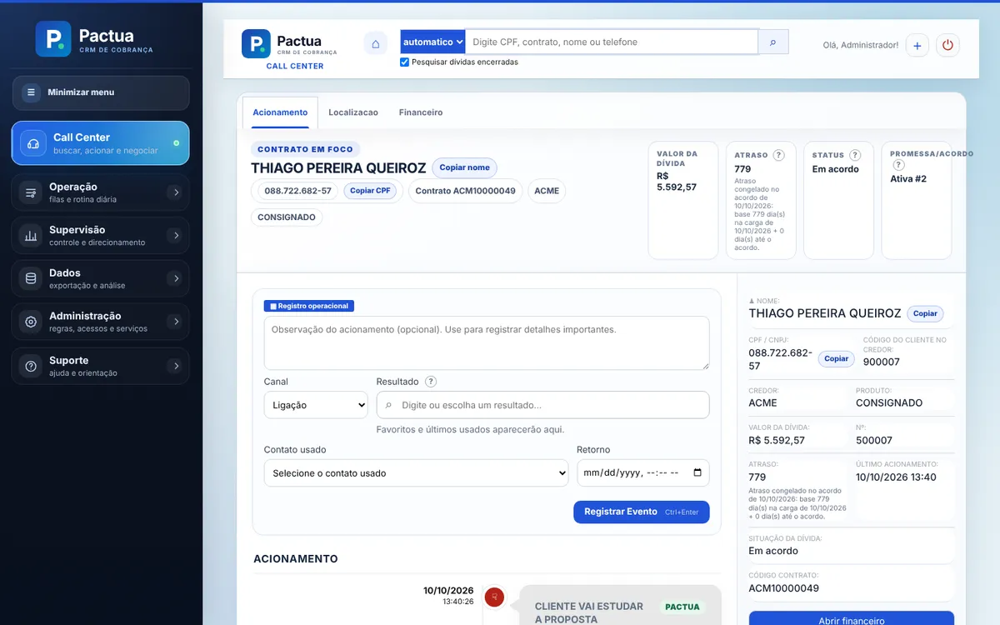
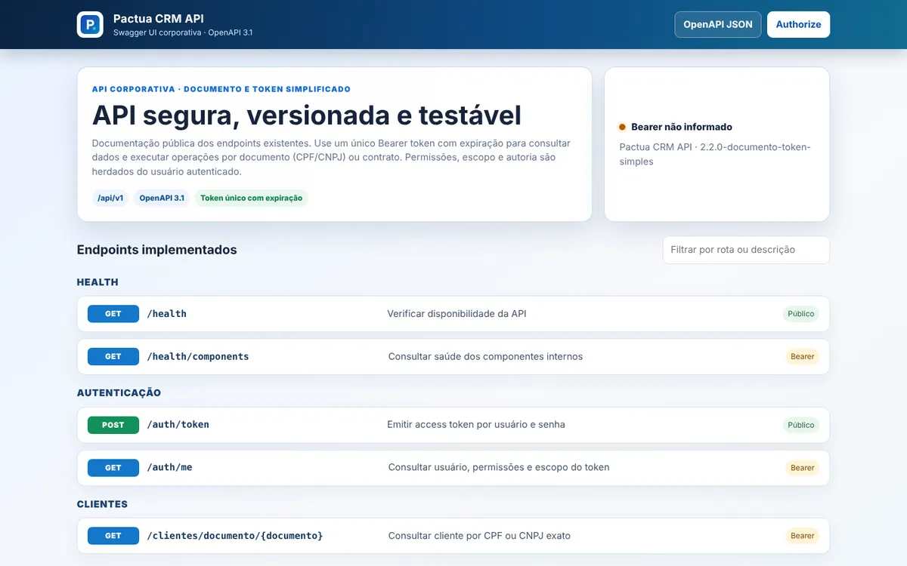

# Pactua · CRM de Cobrança

Sistema de call center para operação de cobrança: importa a carteira enviada pelo credor, organiza filas e estratégias para os operadores, registra acionamentos, negocia e fecha acordos direto no sistema do credor, acompanha parcelas e boletos e entrega relatórios e dashboards para a supervisão.

Escrevi e mantive este sistema em produção numa operação real de cobrança. Esta é a versão pública: o credor e as integrações foram trocados por um credor fictício (**ACME**) e por um simulador da API dele. Nenhum dado, endereço ou credencial real está no repositório.



**Stack:** PHP 8.4 sem framework · MySQL 8.4 · Redis · Debezium + Redpanda (CDC) · OpenSearch · ClickHouse · Apache · Docker Compose · PHPUnit 12 · GitHub Actions

## O que tem aqui

- **Cargas do credor.** Arquivos diários (via SFTP agendado ou upload) passam por recepção com hash, camada raw, staging canônico com validação linha a linha e só então são aplicados nas tabelas oficiais, em lotes e com proteção de espaço em disco. Uma carga de centenas de milhares de contratos não derruba a operação.
- **Tela do operador ("Call Center").** Busca por CPF, contrato, nome ou telefone; ficha com acionamento, localização (telefones, e-mails, endereços sincronizados com o credor) e financeiro (simulação de propostas, fechamento de acordo, parcelas, boleto em PDF).
- **Acordos.** Um único acordo ativo por contrato, lock contra fechamento duplicado, conciliação com o credor antes de considerar um acordo quebrado e regras de carência por credor e produto.
- **Estratégias e filas.** Segmentação da carteira, distribuição entre operadores, agenda de retornos e acompanhamento de resultados.
- **Supervisão.** Dashboard com funil (contactados, alô, CPC, acordos) por período, credor e lote; relatórios CSV em streaming; trilha de auditoria de tudo que muda.
- **API REST** em `/api/v1`, documentada em OpenAPI 3.1, com Bearer token opaco (só o hash fica no banco), permissões e escopo herdados do usuário, rate limit no Redis e `Idempotency-Key` nas escritas.
- **Integração assíncrona com o credor.** Acionamentos e contatos vão para uma fila de saída (*outbox*) e um worker entrega com retry exponencial. O cliente HTTP tem cache de token com lock, circuit breaker e log estruturado com CPF mascarado.
- **CDC.** O Debezium lê o binlog do MySQL e publica no Redpanda; workers atualizam projeções no OpenSearch (busca e dashboards) e no ClickHouse (analítico), com fila de retry.
- **Operação.** Instalador idempotente para VM Linux, migrations versionadas, backup diário, monitores com alerta por e-mail, métricas para Grafana/Zabbix e um runbook para o time de infraestrutura.

## Arquitetura

```text
Operador (Call Center) / API REST
            |
            v
      PHP 8.4 + Apache ----------------------------> Redis (sessão, cache, rate limit)
            |
            v
         MySQL 8.4  ------------------ fonte oficial dos dados
          |      |
          |      +--> outbox --> Integration Worker --> API do credor (ACME / simulador)
          |
          +--> Debezium --> Redpanda --> CDC Workers --> OpenSearch  (busca, dashboards)
                                                    \--> ClickHouse  (analítico)
```

O código em `app/src` é organizado por módulo (`Api`, `Auth`, `Cargas`, `Operacao`) e infraestrutura (`Cdc`, `Search`, `Analytics`, `Redis`, `Http`, `Security`). As telas ficam em `app/public/operacao`, a API em `app/public/api`.

Credores entram por adapters: `CredorAdapterInterface` para consultas e acordo, `IntegracaoSaidaAdapterInterface` para os envios da fila. O contrato da API do credor está em [`docs/CREDOR_API.md`](docs/CREDOR_API.md).

## Telas

| Supervisão | Controle de acordos |
|---|---|
|  |  |
| **Acionamento** | **Documentação da API** |
|  |  |

As imagens são do ambiente de demonstração descrito abaixo, com dados gerados.

## Rodando localmente

Requer Docker com Compose. São 15 containers (os limites de memória somados chegam a uns 9 GB), então use uma máquina com pelo menos 8 GB livres.

```bash
cp .env.example .env.local          # troque os valores ALTERE_AQUI
docker compose --env-file .env.local up -d --build
bash scripts/migrate.sh             # schema inicial + migrations
```

O CRM fica em `http://localhost:8080/operacao/` (usuário `admin`, senha inicial `admin123`, troca obrigatória no primeiro acesso) e a documentação da API em `http://localhost:8080/api/docs/`.

Para ter dados na tela:

```bash
docker compose --env-file .env.local exec php php console/gerar_carga_demo.php --quantidade=300
docker compose --env-file .env.local exec php php console/processar_acme_diario.php
docker compose --env-file .env.local exec php php console/seed_tabulacoes_acme.php --confirmar
docker compose --env-file .env.local exec php php console/popular_demo_api.php --url=http://apache --senha=SUA_SENHA
```

Os dois primeiros geram uma carga fictícia (CPFs com dígito verificador válido, gerados aleatoriamente) e a importam pelo mesmo pipeline de produção. Os dois últimos cadastram as tabulações do credor e usam a própria API REST para registrar acionamentos e fechar acordos no simulador.

Para uma VM Linux de produção, o [`instalar-vm.sh`](instalar-vm.sh) faz tudo de ponta a ponta (Docker, fuso, migrations, índices, workers, cron e rotação de logs). Detalhes em [`docs/INSTALACAO_VM_LINUX.md`](docs/INSTALACAO_VM_LINUX.md).

## Testes

Mais de 500 testes PHPUnit (unitários e de integração contra MySQL e Redis de verdade), incluindo um teste de contrato que roda o cliente HTTP real contra o simulador do credor. O GitHub Actions sobe MySQL 8.4 e Redis, aplica o schema na mesma ordem do `scripts/migrate.sh` e roda a suíte a cada push.

```bash
cd app && composer install
DB_HOST=127.0.0.1 DB_DATABASE=crm_test DB_USERNAME=root DB_PASSWORD=... \
REDIS_CACHE_HOST=127.0.0.1 REDIS_QUEUE_HOST=127.0.0.1 vendor/bin/phpunit
```

O banco de teste pode ser preparado com `bash scripts/ci/prepare-db.sh`.

## Segurança

- Senhas com `password_hash`, troca obrigatória da senha inicial, bloqueio por tentativas e sessão com prazo absoluto.
- CSRF nos formulários, escape de saída e cabeçalhos de segurança nas respostas da API.
- Escopo por credor e carteira aplicado nas consultas (o operador só vê os contratos do escopo dele, inclusive na API).
- Credenciais SFTP das rotinas de carga criptografadas com libsodium; segredos só no `.env.local`, nunca no banco ou no Git.
- Portas internas (MySQL, Redis, OpenSearch, ClickHouse, Redpanda, Debezium) publicadas apenas em `127.0.0.1`.

## Documentação

- [`docs/CREDOR_API.md`](docs/CREDOR_API.md): contrato da API do credor e regras aplicadas pelo CRM.
- [`docs/GUIA_API.md`](docs/GUIA_API.md): como emitir token e usar a API.
- [`docs/COMANDOS.md`](docs/COMANDOS.md): comandos operacionais da stack.
- [`docs/RUNBOOK_SUPORTE.md`](docs/RUNBOOK_SUPORTE.md): primeiro atendimento, quando escalar e incidentes conhecidos.
- [`docs/CHECKLIST_ENTREGA.md`](docs/CHECKLIST_ENTREGA.md): checklist de cada mudança em produção.
- [`docs/integracoes/`](docs/integracoes/): dashboards e alertas para Grafana e Zabbix.

## Autor

Wagner Gonçalves Longo Filho · [github.com/wagnerglongo](https://github.com/wagnerglongo)
